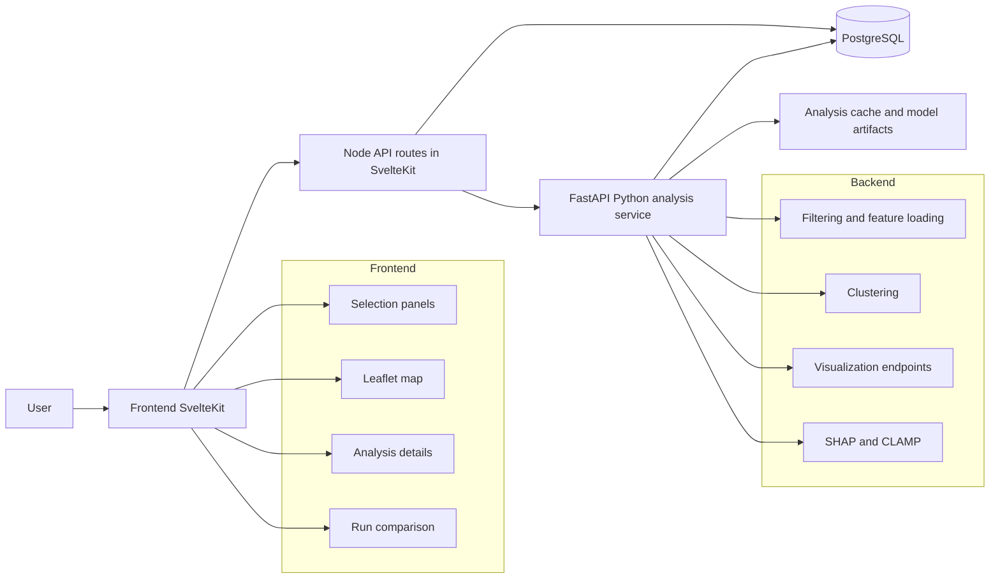

# DAE-PFAS

## Automatic local launcher — Windows, macOS and Linux

No Docker is required. From the project folder:

- **Windows (PowerShell or CMD):** `./run.cmd`
- **macOS / Linux:** `sh run.sh`

The launcher installs missing application runtimes and dependencies, prepares a separate
local PostgreSQL instance, imports a real data extract, and starts the application.
It preserves existing databases and checks service readiness before opening the browser.
See [INSTALL_RUN.md](INSTALL_RUN.md) for full-data import, diagnostics, repair, tests,
supported systems, and operating-system prerequisites.

DAE-PFAS is an interactive PFAS exploration and clustering platform built around a web map, a PostgreSQL data layer, and a Python analysis service.

The project helps users:

- explore PFAS measurement points on a map
- filter data by category, matrix, dataset, year, area, and substance
- run clustering analyses on filtered data
- inspect condensed spatial groups and detailed point information
- visualize temporal and radar summaries
- compare saved analysis runs

This repository contains both the application used by end users and the experimental notebooks/scripts used to prepare data and evaluate models.

## Table of Contents

- [Project Overview](#project-overview)
- [Main Features](#main-features)
- [Tech Stack](#tech-stack)
- [Architecture](#architecture)
- [Repository Structure](#repository-structure)
- [Data and Analysis Pipeline](#data-and-analysis-pipeline)
- [Prerequisites](#prerequisites)
- [Environment Variables](#environment-variables)
- [Installation](#installation)
- [Run the Project](#run-the-project)
- [How to Use the Application](#how-to-use-the-application)
- [Available Analysis Methods](#available-analysis-methods)
- [Useful Scripts and Research Assets](#useful-scripts-and-research-assets)
- [Troubleshooting](#troubleshooting)
- [Known Limitations](#known-limitations)

## Project Overview

DAE-PFAS is an enhanced PFAS Data Hub designed for:

- spatial exploration of PFAS observations
- interactive filtering of large environmental datasets
- unsupervised clustering workflows on selected PFAS subsets
- visual interpretation of clusters through temporal, radar, SHAP, and CLAMP-based views

The main end-user application lives in:

- `Projet/PDHv2` for the SvelteKit frontend and Node-side API routes
- `Projet/model` for the FastAPI analysis backend and research/model code

The database is initialized from a notebook:

- `Projet/PDHv2/init_db.ipynb`

## Main Features

- Interactive PFAS map with point and condensed cluster display modes
- Geographic selection with lasso/area workflows
- Filtering by category, dataset, matrix, years, and substances
- Analysis execution from the UI
- Support for multiple clustering algorithms
- Run history and run comparison page
- Temporal and radar visualizations
- SHAP explanations
- CLAMP explanation endpoint
- Bubble context and point detail retrieval
- Python API connectivity check from the frontend

## Tech Stack

### Frontend

- SvelteKit
- Svelte 5
- TypeScript
- Tailwind CSS
- Leaflet
- D3
- Bits UI

### Backend

- FastAPI
- SQLAlchemy
- pg8000
- pandas
- numpy
- scikit-learn

### Database

- PostgreSQL

### Research / Advanced Modeling

- SAINT-based embeddings
- ProPos integration
- TabPFN comparison scripts
- SHAP
- HDBSCAN
- PyTorch for live SAINT embedding generation

## Architecture



### Runtime Responsibilities

#### 1. SvelteKit frontend

The frontend is responsible for:

- rendering the UI
- managing filters and client state
- displaying maps, points, clusters, charts, and run history
- calling local API routes under `src/routes/api`

#### 2. SvelteKit server routes

The Node-side routes are responsible for:

- reading PostgreSQL data used to bootstrap filters and metadata
- forwarding analysis and visualization requests to the Python service
- normalizing API communication between the UI and the backend services

Examples:

- `/api/info`
- `/api/filter-points`
- `/api/analysis/run`
- `/api/analysis/shap`
- `/api/analysis/clamp`
- `/api/visualization/temporal`
- `/api/visualization/radar`

#### 3. FastAPI analysis backend

The Python backend is responsible for:

- reading PFAS data from PostgreSQL
- preparing matrices and selected features
- loading or generating embeddings
- executing clustering algorithms
- computing condensed spatial groups
- generating explanation and visualization payloads

#### 4. PostgreSQL

The database stores:

- point vectors
- metadata
- substance reference information
- materialized views used by the UI initialization
- cached or persisted analysis session information

## Repository Structure

```text
.
├── README.md
└── Projet
    ├── PDHv2
    │   ├── package.json
    │   ├── .env.example
    │   ├── init_db.ipynb
    │   ├── full.csv
    │   ├── src
    │   │   ├── routes
    │   │   ├── lib/components
    │   │   ├── lib/runes
    │   │   ├── lib/server
    │   │   └── lib/utils
    │   └── static
    ├── model
    │   ├── main.py
    │   ├── saint_loader.py
    │   ├── saint_live.py
    │   ├── visualization.py
    │   ├── clamp
    │   ├── saint_local
    │   ├── ProPos-master
    │   ├── preserved_default_cache_20260629
    │   ├── compare_all_cases.py
    │   ├── test_tabpfn_vs_saint.py
    │   └── notebooks and output artifacts
    └── package.json
```

### Important Directories

- `Projet/PDHv2`: main application
- `Projet/PDHv2/src/routes`: pages and API routes
- `Projet/PDHv2/src/lib/components`: reusable UI and analysis components
- `Projet/PDHv2/src/lib/server`: PostgreSQL access and Python proxy helpers
- `Projet/model`: Python backend and research code
- `Projet/model/clamp`: CLAMP-related logic
- `Projet/model/saint_local`: SAINT data and outputs
- `Projet/model/preserved_default_cache_20260629`: preserved reference cache used by the backend

## Data and Analysis Pipeline

### Data ingestion

The database initialization notebook:

- reads the source CSV dataset
- builds `point`, `metadonnee`, and `substance_ref`
- creates indexes and helper structures
- prepares the database for the UI and the analysis service

Notebook:

- `Projet/PDHv2/init_db.ipynb`

### Frontend bootstrap

When the app starts, the frontend requests `/api/info` to load:

- available matrices
- available datasets
- available substances and units

These values are used to populate the filters.

### Analysis flow

When a user launches an analysis:

1. the frontend sends the request to a local SvelteKit API route
2. the route forwards the request to the FastAPI service
3. the Python service loads the filtered data from PostgreSQL
4. embeddings or transformed features are prepared
5. the selected clustering algorithm runs
6. results, summaries, assignments, and condensed groups are returned
7. the frontend renders the results and stores the run in history

## Prerequisites

Before running the project, make sure you have:

- Node.js 20 or newer
- npm
- Python 3.10+ or 3.11+
- PostgreSQL running locally or remotely
- Jupyter Notebook or JupyterLab for database initialization

Recommended:

- `python -m venv` for an isolated Python environment

## Environment Variables

### Database variables

The project expects the following variables:

```env
DB_HOST=localhost
DB_PORT=5432
DB_NAME=DAE-PFAS
DB_USER=postgres
DB_PASSWORD=your_password_here
```

### Python API variables

Optional if you use the default local backend:

```env
PYTHON_API_URL=http://127.0.0.1:8000
VITE_PYTHON_API_URL=http://127.0.0.1:8000
PY_ANALYSIS_API_URL=http://127.0.0.1:8000
```

### Where to place them

Use at least one of the following approaches:

#### Option A: frontend `.env`

Create:

- `Projet/PDHv2/.env`

from:

- `Projet/PDHv2/.env.example`

#### Option B: backend `.env`

Create:

- `Projet/model/.env`

with the same `DB_*` variables so `main.py` can read them through `load_dotenv()`.

#### Option C: export variables in your shell

You can also export all variables before starting the frontend and backend.

## Installation

### 1. Clone the repository

```bash
git clone <github.com/ayatbouhrir/pfas-data-hub-analytics>
cd <pfas-data-hub-analytics>
```

### 2. Install frontend dependencies

```bash
cd Projet/PDHv2
npm install
cd ../..
```

### 3. Create a Python virtual environment

```bash
python3 -m venv .venv
source .venv/bin/activate
```

### 4. Install Python dependencies

There is currently no single `requirements.txt` for the application runtime, so install the core packages manually:

```bash
pip install fastapi "uvicorn[standard]" pandas numpy python-dotenv sqlalchemy pg8000 scikit-learn pyarrow pydantic jupyterlab
```

Optional packages for advanced features:

```bash
pip install shap hdbscan torch matplotlib
```

Optional packages for research scripts only:

```bash
pip install tabpfn tabpfn-extensions
```

### 5. Prepare PostgreSQL

- create a PostgreSQL database
- make sure the server is running
- configure the `DB_*` variables

Example:

```sql
CREATE DATABASE "DAE-PFAS";
```

### 6. Initialize the database

Open and run:

- `Projet/PDHv2/init_db.ipynb`

This notebook is responsible for:

- importing the PFAS dataset
- creating the main SQL tables
- populating the database
- building indices and helper structures

Important:

- the dataset is large
- the import can take a long time
- this is a mandatory step before using the app

## Run the Project

You need two terminals:

- one for the Python backend
- one for the SvelteKit frontend

### Terminal 1: run the Python backend

```bash
cd Projet/model
source ../../.venv/bin/activate
uvicorn main:app --host 127.0.0.1 --port 8000 --reload
```

The backend will be available at:

- `http://127.0.0.1:8000`

Useful health endpoints:

- `GET /`
- `GET /gettest`
- `GET /health`

### Terminal 2: run the frontend

```bash
cd Projet/PDHv2
npm run dev
```

The frontend will usually be available at:

- `http://localhost:5173`

### Build for production

```bash
cd Projet/PDHv2
npm run build
npm run preview
```

## How to Use the Application

### Home page

The home page allows users to:

- browse PFAS points on the map
- filter by category
- filter by matrix and dataset
- restrict years
- select a geographic area
- choose substances and units
- inspect individual point details

### Analysis page

The analysis page allows users to:

- verify Python API connectivity
- launch a clustering analysis
- inspect results on the map
- switch between raw points and condensed views
- open details about clusters and points
- use additional views such as temporal and radar charts
- access explanation panels such as SHAP and CLAMP when available

### Suggested user workflow

1. Start PostgreSQL
2. Start the Python backend
3. Start the frontend
4. Open the app in the browser
5. Select a category
6. Filter by dataset, matrix, years, and substances
7. Select an area on the map if needed
8. Open the analysis page
9. Choose an analysis method and parameters
10. Run the analysis
11. Inspect clusters, summaries, and visualizations
12. Save and compare runs when needed

## Available Analysis Methods

Based on the current backend code, the project supports or references:

- KMeans
- DBSCAN
- HDBSCAN
- ProPos
- BIRCH-based condensation
- SAINT-based reduction / embeddings
- PCA
- t-SNE

### Interpretation helpers

- SHAP explanations
- CLAMP explanations
- temporal visualizations
- radar visualizations

## Useful Scripts and Research Assets

These files are useful for experimentation, model comparison, or research workflows, even if they are not part of the minimal runtime:

- `Projet/model/compare_all_cases.py`
- `Projet/model/test_tabpfn_vs_saint.py`
- `Projet/model/propos.ipynb`
- `Projet/model/propos_tabpfn.ipynb`
- `Projet/model/SAINT_PFAS.ipynb`
- `Projet/model/saint_map.py`
- `Projet/model/saint_3d.py`
- `Projet/model/saint_map_3d_clean.py`

These assets include:

- exploratory comparisons
- SAINT latent space experiments
- ProPos experiments
- TabPFN comparisons
- generated plots and output artifacts

## Troubleshooting

### Frontend starts but no data appears

Check:

- PostgreSQL is running
- the database has been initialized with `init_db.ipynb`
- `DB_*` variables are correctly set

### Analysis page shows Python API unavailable

Make sure the backend is running:

```bash
cd Projet/model
source ../../.venv/bin/activate
uvicorn main:app --host 127.0.0.1 --port 8000 --reload
```

### Error about Python service unreachable

Verify:

- `PYTHON_API_URL` points to `http://127.0.0.1:8000`
- the backend is started before launching analysis

### Database connection errors

Verify:

- `DB_HOST`
- `DB_PORT`
- `DB_NAME`
- `DB_USER`
- `DB_PASSWORD`

### Notebook import is too slow

This is expected on large datasets. Use:

- enough disk space
- enough RAM
- a stable PostgreSQL instance

## Known Limitations

- The project does not currently provide a single unified Python `requirements.txt` for runtime setup.
- The repository contains both production code and research artifacts, which can make onboarding less direct.
- Some advanced features depend on optional libraries such as `torch`, `shap`, `hdbscan`, `tabpfn`, and `tabpfn-extensions`.
- Database initialization is notebook-based, so first-time setup is heavier than a one-command bootstrap.

## Summary

To run the project successfully, a user must:

1. install Node.js, Python, PostgreSQL, and Jupyter
2. configure the database variables
3. initialize PostgreSQL data using `Projet/PDHv2/init_db.ipynb`
4. start the FastAPI backend from `Projet/model`
5. start the SvelteKit frontend from `Projet/PDHv2`
6. open the web app and use filters, map interactions, and analysis tools

This README is intended to be the main GitHub entry point for both developers and end users working with the DAE-PFAS project.
