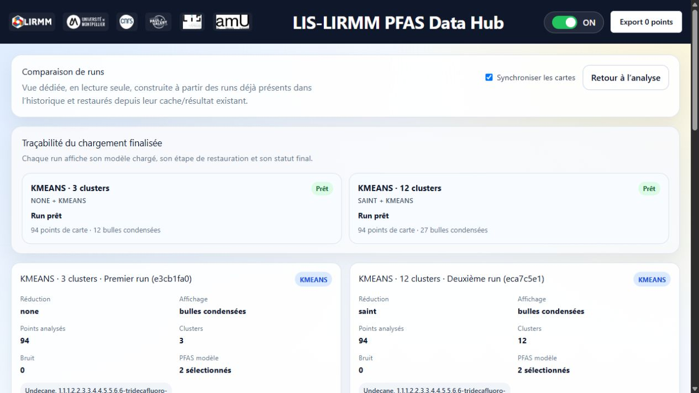

# Validation de la réorganisation — Windows, 29 octobre 2026

## Résultat des contrôles

La référence avant migration et les passages après migration réussissent :

- 16/16 tests du lanceur (`tests/test_launcher.py`).
- 48/48 contrôles HTTP fonctionnels (`scripts/test_local.py`).
- Svelte/TypeScript : 0 erreur, les 3 avertissements CSS déjà présents.
- Compilation de production réussie depuis `frontend/`.
- Syntaxe des 28 fichiers Python maintenus et des cellules Python des notebooks vérifiée.
- Syntaxe PowerShell vérifiée ; syntaxe de `run.sh` vérifiée avec Git Bash sur Windows.

Les contrôles HTTP couvrent les trois pages, métadonnées, carte, filtres de jeu de
données/matrice/année/lasso/NUTS/substance, détails et statistiques de points,
unités, histogramme, CSV, sites contextuels, validation des entrées,
KMeans/DBSCAN/HDBSCAN/ProPos, PCA/t-SNE/autoencodeur/SAINT, mode simple, cache,
BIRCH, graphiques temporel et radar, SHAP, CLAMP et historique.
Ils utilisent l'extrait installé et notamment les 94 points Danube. Ils ne
constituent pas une validation exhaustive de tous les jeux ou paramètres.

Journaux dans `.local/` : `reorganisation-baseline.log`,
`reorganisation-unit-tests.log`, `reorganisation-final-tests.log` (types,
compilation et 48 contrôles après réparation), `reorganisation-restored-runtime-tests.log`
(48/48 avec les versions Python d'origine), `reorganisation-fresh-install.log`,
`reorganisation-repair.log`, `reorganisation-port-recovery.log` et son JSON,
`reorganisation-preservation.json`, `reorganisation-database-final.json`.

## Installation et cycle de vie

L'installation d'un nouveau cluster PostgreSQL privé et l'import par lots sont
testés dans un dossier temporaire, avec les runtimes déjà installés. Le test
vérifie NUTS, la répétition de l'installation et l'isolation des bases existantes.
Le cluster temporaire utilise 5435, puis est arrêté.

`--repair --setup-only --data none` réussit, avec une nouvelle installation npm
depuis le verrou. Les versions Python ouvertes de la procédure existante proposent
cinq changements : MarkupSafe 3.0.3→3.0.4, opentelemetry-api 1.45.1→1.45.2,
Pydantic 2.14.1→2.14.2, pydantic-core 2.50.1→2.50.2 et setuptools 78.1.0→84.2.1.
Pour conserver le périmètre, l'environnement Python d'origine est restauré depuis
la sauvegarde, puis les 16+48 tests repassent. La copie réparée est conservée dans
`after-repair-venv/` dans la sauvegarde privée. Un futur `--repair` peut encore
résoudre de nouvelles versions selon les contraintes existantes ; le verrouillage
des versions Python reste une étape séparée.

Un essai réel occupe 5173 et 8000 avec deux serveurs étrangers au projet.
Le lanceur choisit 5174 et 8001 ; la santé du backend et le proxy Python répondent.
La relance conserve les mêmes processus. L'arrêt laisse les serveurs étrangers
actifs. Après libération des ports, le projet redémarre sur 5173/8000.
Ce scénario vérifie le démarrage et le proxy, pas toutes les fonctions sur ports
alternatifs : la limite du proxy de condensation est indiquée plus bas.

`run.cmd --doctor`, `npm run doctor` et `npm run start:local -- --no-open`
fonctionnent. La commande npm réutilise les services du projet existants.
Les wrappers et la gestion
des processus utilisent les nouveaux dossiers et scripts Python renommés.

## Interface contrôlée dans le navigateur

Vérifications effectuées : exploration, sélection Danube, points et zoom,
CSV téléchargé et relu (94 lignes de données), rechargement d'une analyse,
relance depuis l'écran, trois clusters, condensation et vue 3D, radar automatique,
SHAP global, règles CLAMP, historique et comparaison de deux analyses avec
cartes, métriques et résultats restaurés.

Le clic automatisé sur un point brut n'a pas permis d'ouvrir le panneau de détail.
Le même comportement est reproduit sur une copie des sources originales issue de
la sauvegarde, servie temporairement sur 5180 avec la même configuration de base.
L'API de détail et les statistiques de points réussissent leurs contrôles HTTP.
L'ouverture du panneau par clic reste donc un parcours non validé dans cet essai ;
sa cause n'est pas attribuée à la migration ni présentée comme corrigée.
La copie de diagnostic est conservée dans `.local/ui-baseline/` ; son serveur
temporaire a été arrêté. Elle ne fait pas partie des sources actives.

Après un chargement direct de la page de comparaison, les deux runs sont prêts
avec 94 points chacun, mais l'en-tête commun affiche « Export 0 points » : son
compteur dépend de l'état d'exploration en mémoire. Ce comportement de l'en-tête,
dont la logique n'est pas modifiée ici, reste à traiter séparément.

Le graphique temporel affiche le message d'année unique pour Danube ; le cas
multiannuel est couvert par HTTP. Le radar manuel signale le besoin d'au moins
trois PFAS ; le radar automatique s'affiche. SHAP affiche une fidélité de 100 %
pour ce cas ; CLAMP affiche PFOS > 1.55. Ces valeurs contrôlent la conservation
du résultat et ne constituent pas une validation scientifique.

## Conservation et traçabilité

Le manifeste final attribue une destination existante à chacun des 63 254 fichiers
initiaux. Il enregistre 30 923 chemins déplacés ou renommés ; aucun fichier initial
n'est sans destination. Un fichier de statistiques PostgreSQL éphémère, régénéré
au démarrage, est conservé dans `archives/regenerated-runtime/`.

Parmi les 654 fichiers hors environnements et données de fonctionnement, 546 sont
identiques et 108 adaptés aux nouveaux chemins ou imports. Les 229 fichiers
contrôlés de modèles, résultats de référence et bibliothèques tierces sont
identiques par SHA256. Les sorties, compteurs d'exécution et métadonnées des
notebooks restent inchangés. L'analyse syntaxique du backend limite les différences
aux paramètres de chemins ; les fonctions scientifiques et contrats restent
identiques. Les deux manifestes frontend et toutes les versions Python installées
correspondent à ceux de la sauvegarde.

L'inventaire logique de la base finale est identique à la référence, par effectifs
et SHA256 des lignes triées : 15 183 points, 14 554 lignes de substances,
126 références et 162 735 associations NUTS. La vue `point` conserve 15 183 lignes.
Les dix clés d'analyses de référence, paramètres, filtres, affectations, résumés
de clusters et métriques sont conservés. Les dates d'ouverture, états de vue et
compteurs de cache peuvent évoluer pendant les contrôles d'interface.

PostgreSQL indépendant sur 5433 reste actif avec le même PID 9056 pendant les
essais. Les opérations ciblent exclusivement la configuration privée du projet
et les clusters temporaires de test. Les identifiants et la configuration du
projet sont identiques à la référence une fois les ports habituels retrouvés.

La sauvegarde privée vérifiée reste disponible. Les manifestes initial et final
sont conservés séparément, avec le journal de migration.

## Limites préexistantes et contrôles non exécutés

- Le filtre NUTS n'est pas transmis au backend d'analyse comme dans l'exploration.
- Une substance nommée peut ne pas correspondre aux colonnes Python `pfas_N` dans `apply_filters`.
- Le proxy de condensation utilise encore le port 8000 en dur.
- Le proxy historique `/api/pfas-time-series` vise une route Python absente ; le graphique actif utilise une autre route.
- WorldPop est indisponible ou expire ; certains fonds externes demandent une clé.
- Les alertes npm déjà relevées restent présentes ; aucune mise à niveau forcée n'est appliquée.
- Les avertissements CSS et d'échappement Python de CLAMP restent présents.
- L'ouverture du détail par clic automatisé sur la carte reste non validée sur les deux versions comparées.

La CI Windows/macOS/Linux est adaptée : arborescence, préparation,
types/compilation, tests du lanceur, contrôles HTTP, relance et arrêt. Elle est
préparée, sans exécution distante attestée ici. Aucune exécution native macOS/Linux
ni installation sur une machine vierge sans runtimes n'est revendiquée. Les
expériences longues, le CSV complet et les accès externes TabPFN ne sont pas rejoués.
